# Synchronization reliability

Phase 4 preserves schema 9, scheduling contract 2, card-content capability 1, operation IDs,
receipts, cursor semantics and the existing native-only cloud availability policy.

## Local commit and foreground liveness

Each owner database is decorated by `PostCommitDatabase` after migrations. Successful standalone
INSERT/UPDATE/DELETE/REPLACE statements notify after their promise resolves. Transactions notify once,
after the underlying COMMIT. Transaction statements use the underlying transaction handle and cannot
notify before COMMIT. Rollbacks do not notify. Notification exceptions are logged and cannot reject a
committed save. All current mutation SQL uses these statements or transactions, including imports,
settings, initial review state and atomic study answers. No screen performs synchronization on save.

Composition subscribes only to the selected database and rebinds on storage changes. A notification is
a hint: after 250 ms the coordinator checks the durable pending count before making a network request.
The interval coalesces interactive edits and imports without postponing a wake indefinitely. Notifications
from acknowledgement/remote transactions produce an empty local check rather than a network loop.

The coordinator has one running promise, one coalescing timer, one retry timer and one recovery timer.
A wake during a run sets `wakePending`. A lifecycle trigger during a run sets `runRequested`, retaining
its need for a pull even if the local queue is empty. Completion cannot clear a newer notification;
it schedules the retained request or pending check. Successful runs also check durable pending work.
An outbox page remains capped at 25 operations and an ordinary pull run at three pages.

Once per 60 seconds while started, a recovery wake checks pending local work when foregrounded and
eligible. This is a repair path for lost notifications and process-local listener errors, not periodic
remote polling: empty, blocked, guest and background checks never initiate HTTP. At most one such
timer exists. Startup, foreground, reconnect, successful authentication/account selection, manual sync,
conflict resolution and selected failed-operation recovery retain their existing meanings. No OS
background-execution guarantee is added. Termination recovery depends on the next startup.

```mermaid
stateDiagram-v2
  [*] --> Idle: start / owner selection
  Idle --> Checking: committed write / recovery wake (250 ms)
  Checking --> Idle: no pending / guest / background
  Checking --> Running: eligible pending
  Idle --> Running: startup / foreground / reconnect / manual
  Running --> Running: coalesce concurrent signals; no overlapping pass
  Running --> Checking: success + newer wake / remaining durable work
  Running --> Idle: complete and empty
  Running --> Backoff: transient failure within budget
  Backoff --> Running: deadline reached while foreground
  Running --> Blocked: auth / capability / permanent pull / exhausted read budget
  Blocked --> Running: explicit manual recovery or new owner/authentication
  Running --> Idle: owner invalidation / stop; ignore late result
```

## Failure classification and retry

The existing jittered policy is retained: `min(60s, 1s * 2^(attempt-1))` before jitter,
0.5–1.5 multiplier, capped at 60s. Retry-After is parsed as seconds or HTTP date, capped at 24 hours,
then receives up to 25% additional jitter. Reconnect does not reset the budget or bypass Retry-After.
An explicit manual run supersedes an obsolete waiting retry. At most one retry timer exists.

Push attempts keep the existing five-attempt persisted operation budget. Network/DNS/connection,
body interruption, timeout, HTTP 429 and 5xx are transient. Exhaustion retains the original operation
as failed; explicit retry is required. Other HTTP validation/authorization errors fail the operation
without automatic retry. A 409 with a conflict uses the existing conflict record. A 401 or 426 retains
pending work and blocks automatic runs until explicit recovery/authentication or an owner change.
Read/preflight failures have at most five attempts per recovery episode; permanent HTTP failures and
invalid JSON do not receive automatic pull retries. Malformed semantic remote pages remain atomic and
receive at most the bounded read budget, then require explicit recovery. No cursor is skipped.
Cancellation from owner/lifecycle invalidation is discarded using the captured revision/epoch.

`status()` retains pending/failed/conflict/cursor/session fields and adds optional `synchronizing`
and `syncError` diagnostics. Local-save success does not imply an acknowledgement. Existing bilingual
network/sync messages handle timeout feedback; no new status framework is introduced.

## Ownership

Every production pass captures a SyncStore bound to the selected physical database and the existing
storage revision. It does not reacquire the mutable database proxy between awaits. Ownership checks
surround network and persistence steps. A scope change invalidates the engine epoch, aborts registered
requests, cancels scheduling and clears obsolete diagnostics. Late receipts cannot be applied to the
new owner. Already-issued database transactions may finish only in the captured original database.
Logout never acknowledges unsent/uncertain work. Subscription cleanup is idempotent; old stop handles
cannot stop a restarted lifetime. Backup/transfer strict synchronization uses the same captured store.

## HTTP deadlines

Every CloudClient transport leg retains its existing 12,000 ms deadline. The deadline begins before
fetch and stays registered through asynchronous JSON body consumption on success and error paths.
204 responses do not parse JSON. Non-JSON HTTP errors retain their status handling; incomplete streams
fail as transport errors. Success JSON decoding errors remain decoding failures. No CloudClient caller
currently consumes binary data; the shared primitive also supports text/arrayBuffer consumers.

`withRequestDeadline` races the entire asynchronous transport/consumer against a terminal rejection,
aborts its controller, composes an optional caller signal using standard event listeners, and removes
the timer/listeners/controller in `finally`. This also bounds transports that ignore abort. Unconsumed
streams are cancelled where supported, including late header arrival. Late consumer completion has no
publication side effects. `request_timeout` and `request_cancelled` are distinct status-0 errors;
session invalidation preserves the existing 401 behavior. Ordinary connection failures retain
`network_error`. Synchronous CPU-bound JSON parsing cannot be preempted by AbortController or timers.

Authentication refresh followed by a request consists of separate bounded transport legs, not one
12-second deadline for the entire public method. There is no automatic retry of authentication,
backup creation, purchases or other unrelated mutations. Only the existing idempotent sync contract
drives automatic upload retry. Dictionary lookup has a separate existing body-covering deadline and
is unchanged. Server payload bounds remain finite (2 MiB sync requests/pages, derived card bounds,
configured backup cap); this phase does not introduce a new streamed response size limiter.

## Integrity, compatibility and verification boundary

A timeout after server commit leaves the operation pending with the same ID, payload and prepared
expected version. Retry recovers its receipt rather than creating another effect. Pull is decoded
completely before `applyPage`; timeout, interruption or invalid JSON cannot advance the cursor. Push
acknowledgements already committed locally survive a later failed pull. No network wait occurs inside
a SQLite transaction. Previous malformed-card, checkpoint/calendar and atomic-answer guards remain.

No schema/API/protocol/backup-format change or backend deployment is needed for Phase 4. Ship the
frontend after native validation with the existing Phase 2/3 backend. Earlier backend-first large-card
requirements still apply. Rolling back the frontend preserves data but reintroduces the two liveness
defects; never reset pending operations or learning history to accommodate rollback.

Permanent tests cover both audit reproductions, commit/run/owner races, retry budgets and real TCP
body stalls using Node native fetch. Actual backend HTTP flows verify a committed but unconsumed
acknowledgement recovers as duplicate and a stalled pull keeps its cursor. Node/Jest/SQLite evidence
does not certify React Native networking/JSI, OS lifecycle, OPFS browsers or SQL Server concurrency.
